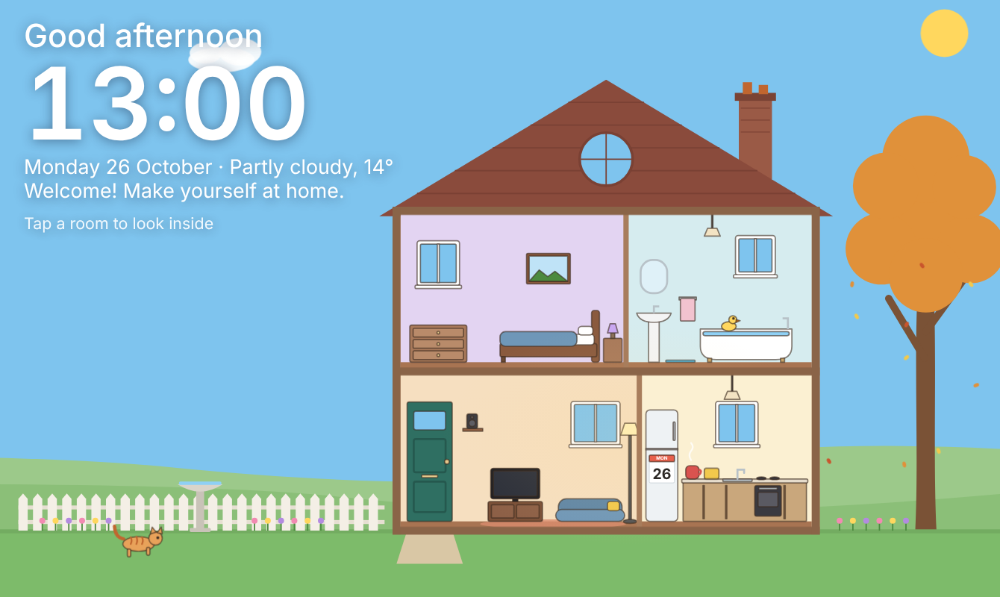
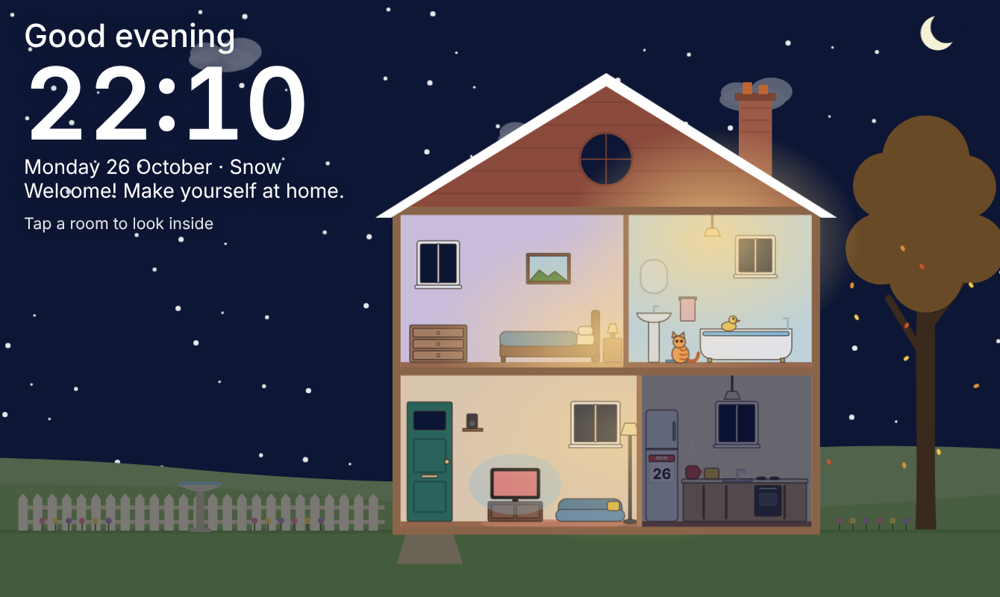
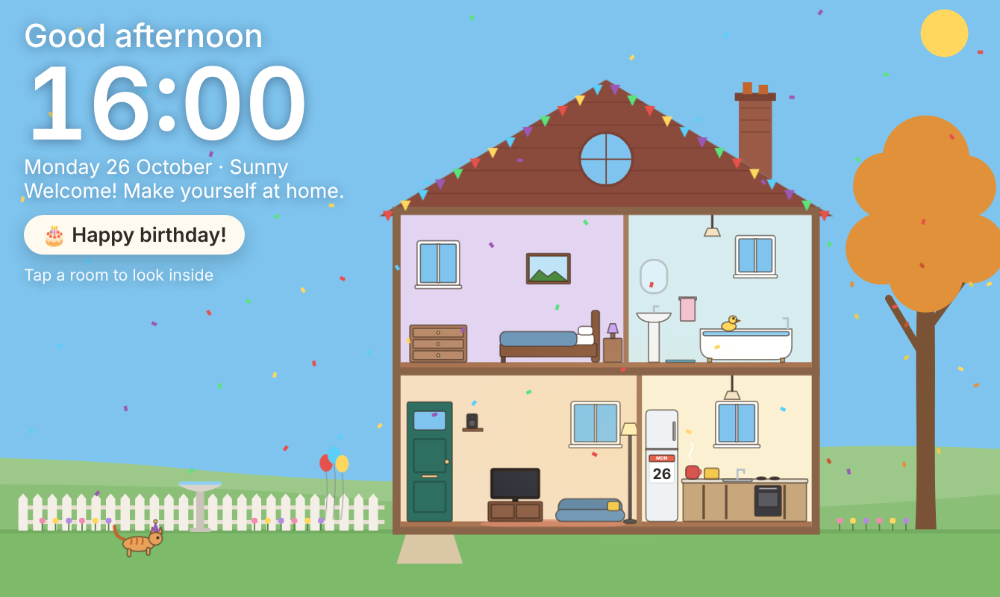
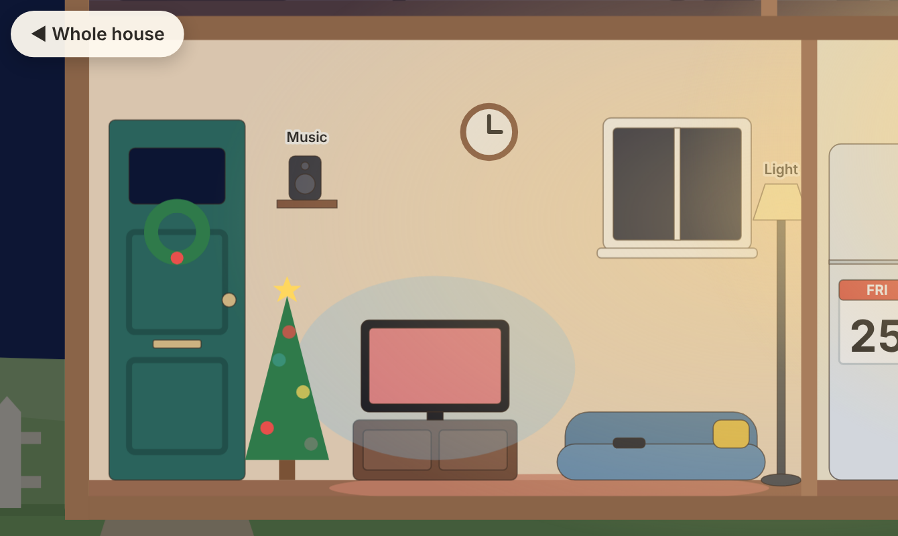

# Wee Hoose

A wee hoose for your hallway tablet, joined up with [Home Assistant](https://www.home-assistant.io/).

It's a little pixel cottage, cut away so you can see into its four rooms. The sky behind it
follows the real sun, from dawn through to a starry night. The real weather falls on it, with
rain on the windows and snow settling on the roof, and the tree in the garden changes with the
seasons. In the evening the lamps come on room by room. A cat wanders about, and the house
dresses up for birthdays, Halloween, Christmas and New Year.

It's also the controls. Guests tap a room to look inside, then tap things in it: the lamp to
switch the real light, the speaker for music, and the bed to say goodnight. There are no menus
or Home Assistant screens, so anyone can work it out.

It works on day one with hardly any smart devices. All it really needs is Home Assistant's
built-in sun and a weather integration. Anything you haven't got just stays part of the picture.

| By day | At night, in the snow | A birthday | Inside a room |
|---|---|---|---|
|  |  |  |  |

## What you need

- **Home Assistant**, any recent version, on your home network.
- **A weather integration.** The Met.no one that Home Assistant sets up out of the box is fine.
- **A calendar** in Home Assistant with birthdays on it, if you'd like the birthday party
  (a Google or local calendar both work). Optional.
- **A tablet** for the wall. Any Android tablet with
  [Fully Kiosk Browser](https://www.fully-kiosk.com/) is ideal, and an old iPad will do. It's
  drawn for a landscape screen.
- **Something to run the panel on** that's always on: the computer Home Assistant is on, a
  Raspberry Pi, a NAS... It needs [Node.js](https://nodejs.org/) 20 or newer, or Docker. There
  are no packages to install.

## Quick start

1. **Copy it** onto the computer that will run it:
   ```sh
   git clone https://github.com/minimal-squashfs/wee-hoose.git
   cd wee-hoose
   ```
2. **Try it first**, with nothing set up: `node server.mjs`, then open
   <http://localhost:8080/>. With no config it runs in **demo mode**, with a pretend lamp and
   speaker.
3. **Fill in the config:**
   ```sh
   cp config.example.jsonc config.jsonc
   ```
   Then change `config.jsonc` to suit your home: Home Assistant's address and your entities.
   Every line is explained in the file. Leave out anything you don't have.
4. **Give it a token** (see [The token](#the-token) below).
5. **Start it** with `node server.mjs`, or `docker compose up -d`. To keep it running after a
   restart, use Docker, or a systemd service, or whatever you usually use.
6. **Set up the tablet:** [docs/tablet-setup.md](docs/tablet-setup.md) takes you through it.
   Point it at `http://<the computer's address>:8080/`.

### The token

The panel needs a Home Assistant *long-lived access token* to read the sun and weather, and
to switch the lamp and the music. It only ever lives on the computer running the panel. The
tablet never sees it.

1. Make a **non-admin user** in Home Assistant just for the panel (how is in
   [docs/tablet-setup.md](docs/tablet-setup.md#a-home-assistant-user-for-the-tablet)).
2. Log in as that user, open its profile (bottom left), go to **Security**, and under
   **Long-lived access tokens** choose **Create token**.
3. Save it in a file called `secrets/ha-token` in this folder (gitignored), or put it in the
   `HA_TOKEN` environment variable instead.

A token can call *any* service in Home Assistant, even for a non-admin user, so the panel
guards it. The page can only ask for the things in your config (that one light, that one
speaker, the Goodnight script). The panel refuses everything else, whatever the page asks for.

The panel itself has no login. Anyone who can reach it on your home network can switch the
lamp and the music, the same as anyone standing at the tablet.

## Don't have...?

- **No smart lights?** The living room's lamp still comes on in the evenings, but it's just
  part of the picture. A **smart plug** on a real lamp works well instead: put the plug's
  `switch.` entity in the config, and tapping the lamp gives On and Off (no dimmer).
- **No smart speaker?** The speaker isn't drawn. A Chromecast, Sonos, Google or Alexa speaker,
  or a Kodi or Music Assistant player, all show up as a `media_player`.
- **No calendar?** No birthday party, but Halloween, Christmas and New Year still happen.
  Home Assistant's *Local calendar* integration is the quickest way to add one.
- **No weather?** The sky just follows the sun (or the clock, if there's no `sun.sun`).
- **Nothing at all yet?** It still works: a clock, a greeting and a house that lives through
  the day.

## Making it yours

Colours, fonts, button sizes, the house's paint and the cat's fur are all in
[public/theme.css](public/theme.css). Celebrations are in
[public/celebrations.js](public/celebrations.js). [docs/customising.md](docs/customising.md)
shows how to repaint the house, add a celebration (anniversaries, Diwali, Burns Night...) and
add more things to tap.

## Testing

```sh
node --test "tests/*.test.mjs"
```

No packages, no Home Assistant needed: the tests use a pretend one. To see any day or weather
without waiting for it, add a preview to the address, for example
`?date=2026-10-31&time=21:00&weather=rainy`, `?celebrate=birthday` or `?room=kitchen`.
Previews never change anything in the house.

## What's next

This is the **minimal version**. A fuller one is planned, with more rooms, TVs and scenes.
See [CHANGELOG.md](CHANGELOG.md).

## Licence

MIT: see [LICENSE](LICENSE). Borrow whatever's useful.
